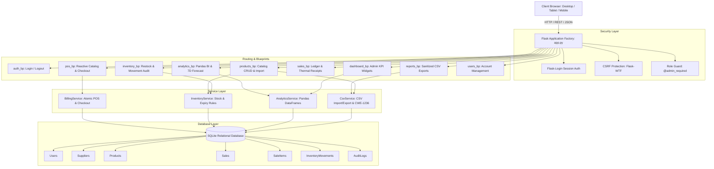
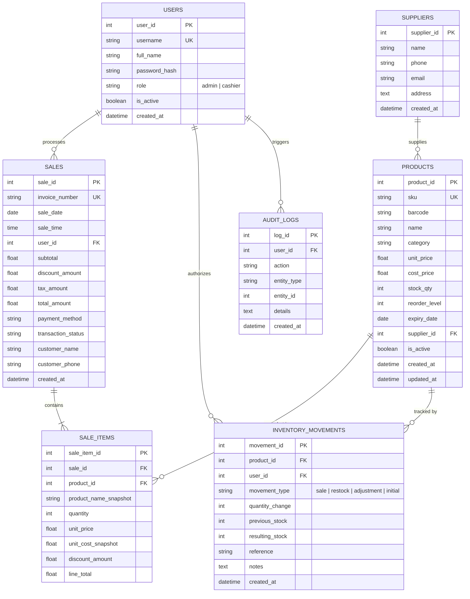

# GreenLeaf Nexus
### Smart Inventory & Sales Management System with Interactive Analytics Dashboard

[](https://www.python.org/)
[](https://palletsprojects.com/p/flask/)
[](https://www.sqlalchemy.org/)
[](https://pandas.pydata.org/)
[](https://plotly.com/)
[]()
[](https://world.openfoodfacts.org/)

> **Brand Identity**: GreenLeaf Grocers  
> **System Name**: GreenLeaf Nexus  
> **Tagline**: *Fresh Stock. Smart Decisions.*

---

## 1. Project Overview & Problem Statement

Independent supermarket chains and grocery retailers face steep operational challenges: fragmented inventory ledgers, perishable stock spoilage from unmonitored expiration dates, slow checkout lanes, and inadequate visibility into profit margins and stock-turn ratios. Most generic retail systems either lack grocery-specific surveillance (expiry tracking and reorder thresholds) or require expensive proprietary cloud subscriptions.

**GreenLeaf Nexus** is a full-stack, enterprise-grade grocery retail ERP and point-of-sale platform built on Python and Flask. It bridges front-counter cashier billing with backend warehouse restocking, automated inventory deduction, multi-period analytics powered by **Pandas**, interactive data visualizations powered by **Plotly**, and role-based access control.

---

## 2. Key Objectives & Highlights

1. **Point of Sale (POS) Billing Terminal**:
   - High-velocity product catalog with live search across product names, SKUs, and barcodes.
   - Reactive shopping cart with instant subtotal, percentage discounts, and configured tax calculations.
   - Client-side responsiveness paired with strict server-side price authoritative validation.
   - Instant thermal-printable receipt generation.
2. **Atomic Inventory Lifecycle & Surveillance**:
   - Real-time stock deduction upon successful checkout wrapped in atomic database transactions.
   - Comprehensive **Inventory Movement Ledger** tracking all restocks, adjustments, and sales.
   - Dual-tier surveillance:
     - **Low-Stock Detection**: Identifies SKUs where `stock_qty <= reorder_level`.
     - **Expiry Date Surveillance**: Identifies expired items and products expiring within 15 days, distinguishing expired, expiring today, and expiring within 7/15 days.
3. **Business Intelligence & Demand Analytics**:
   - Time-series daily and monthly sales trajectories via Plotly.
   - Category performance breakdown and percentage gross revenue contribution.
   - Slow-moving stock detection (items with 0 or minimal sales in 30 days).
   - **7-Day Demand Forecasting**: Moving average daily demand calculations combined with safety-stock buffers to recommend automated replenishment order quantities.
4. **Data Portability & Security**:
   - Bulk CSV product imports with strict header validation, date formatting, duplicate SKU detection, and row-level error logs.
   - Downloadable CSV reports for Sales, Inventory, and Alert manifests sanitized against formula injection (CWE-1236).
   - Role-Based Access Control (**Admin** vs. **Cashier**) with session isolation.

---

## 3. Technology Stack

| Layer | Technologies |
| :--- | :--- |
| **Backend Framework** | Python 3.14, Flask 3.1.3, Flask-Login 0.6.3, Flask-WTF 1.3.0 |
| **ORM & Database** | Flask-SQLAlchemy 3.1.1, SQLite with WAL mode, foreign keys, and indexes |
| **Data Analysis** | Pandas 3.0.6, NumPy 2.5.4 |
| **Charts & Visualizations** | Plotly 7.1.0 (CDN client-side rendering) |
| **Frontend & UI** | Semantic HTML5, CSS3 Custom Properties (Design System), Bootstrap 5, Bootstrap Icons |
| **Validation & Security** | Werkzeug password hashing (Scrypt), CSRF Protection, CSV Formula Neutralization |
| **Testing** | Pytest 9.1.1, Flask Test Client with isolated in-memory database |

---

## 4. System Architecture



---

## 5. Database Schema & ER Diagram



---

## 6. Installation & Quick Start

### Prerequisites
- Python 3.10 to 3.14 installed on your machine.
- Git (optional).

### Step 1: Clone or Navigate to the Workspace
```powershell
cd "c:\Users\subha\OneDrive\Desktop\Inventory & Sales Management System with Analytics Dashboard for GreenLeaf Grocers"
```

### Step 2: Set Up Virtual Environment

**Windows PowerShell:**
```powershell
python -m venv .venv
.\.venv\Scripts\Activate.ps1
```

**macOS / Linux:**
```bash
python3 -m venv .venv
source .venv/bin/activate
```

### Step 3: Install Required Dependencies
```powershell
pip install -r requirements.txt
```

### Step 4: Environment Variables Setup
Copy the example environment configuration:
```powershell
cp .env.example .env
```

Key environment settings inside `.env`:
- `SECRET_KEY`: Random cryptographic key for sessions and CSRF protection.
- `DATABASE_URL`: Location of the SQLite database (default: `sqlite:///instance/greenleaf.db`).
- `TAX_RATE`: Store tax rate (default: `0.05` for 5% VAT/GST).
- `MAX_DISCOUNT_PERCENT`: Maximum permitted cashier discount percentage (default: `30.0`).

### Step 5: Seed Demonstration Data
Execute the deterministic data generator to create **55 distinct products**, **5 wholesale suppliers**, **3 user accounts**, and **520 realistic sales transactions** distributed across the last 4 months:
```powershell
python seed_data.py
```

### Step 6: Start the Application Server

#### Option A: Run the Flask Web Application
```powershell
python app.py
```
Open your web browser and navigate to:
```
http://127.0.0.1:5000
```

#### Option B: Run the Interactive Streamlit Analytics Dashboard
```powershell
streamlit run streamlit_app.py
```
Open your web browser and navigate to:
```
http://localhost:8501
```

### Step 7: Cloud Hosting & Deployment

#### ☁️ Streamlit Community Cloud Hosting
1. Push your repository to GitHub: `https://github.com/SubhadeepBhandari25/GreenLeaf-Nexus`.
2. Go to [share.streamlit.io](https://share.streamlit.io) and log in with your GitHub account.
3. Click **"New app"** and select:
   - **Repository**: `SubhadeepBhandari25/GreenLeaf-Nexus`
   - **Branch**: `main`
   - **Main file path**: `streamlit_app.py` (or `app.py`)
4. Click **Deploy!** The cloud environment will install `requirements.txt` and auto-initialize the database with demo products, sales trajectories, and POS terminal.

#### 🚀 Full Flask App Hosting (Render / Railway / Heroku)
A production `Procfile` is included:
```text
web: gunicorn "app:create_app()"
```
- **Render**: Connect repo as a Web Service, Build command: `pip install -r requirements.txt`, Start command: `gunicorn "app:create_app()"`.

---

## 7. Demo Credentials

| Role | Username | Password | Accessible Modules |
| :--- | :--- | :--- | :--- |
| **Administrator** | `admin` | `admin123` | **Full Access**: Dashboard, POS, Products, Inventory, Suppliers, Sales, Analytics, Reports, User Management |
| **Cashier 1** | `cashier1` | `cashier123` | **Point of Sale**, Checkout, Thermal Receipt Printing, Permitted Sales History |
| **Cashier 2** | `cashier2` | `cashier123` | **Point of Sale**, Checkout, Thermal Receipt Printing, Permitted Sales History |

---

## 8. Automated Testing

GreenLeaf Nexus includes **30 automated test cases** implemented with `pytest` covering authentication, product catalog rules, transactional billing, inventory surveillance, Pandas analytics, CSV data pipelines, and role-based security.

To run the complete automated test suite:
```powershell
python -m pytest -v
```

### Test Suite Execution Output:
```text
tests/test_analytics.py::test_empty_period_analytics PASSED              [  3%]
tests/test_analytics.py::test_analytics_with_sales_data PASSED           [  6%]
tests/test_auth.py::test_valid_admin_login PASSED                        [ 10%]
tests/test_auth.py::test_valid_cashier_login PASSED                      [ 13%]
tests/test_auth.py::test_invalid_login_wrong_password PASSED             [ 16%]
tests/test_auth.py::test_inactive_account_rejected PASSED                [ 20%]
tests/test_auth.py::test_logout PASSED                                   [ 23%]
tests/test_billing.py::test_correct_total_calculation PASSED             [ 26%]
tests/test_billing.py::test_calculation_with_discount PASSED             [ 30%]
tests/test_billing.py::test_successful_checkout_and_stock_deduction PASSED [ 33%]
tests/test_billing.py::test_insufficient_stock_rejection_and_rollback PASSED [ 36%]
tests/test_billing.py::test_empty_cart_rejection PASSED                  [ 40%]
tests/test_billing.py::test_invalid_discount_rejection PASSED            [ 43%]
tests/test_csv.py::test_sanitize_csv_cell PASSED                         [ 46%]
tests/test_csv.py::test_valid_csv_import PASSED                          [ 50%]
tests/test_csv.py::test_invalid_csv_rows_reported PASSED                 [ 53%]
tests/test_csv.py::test_csv_export PASSED                                [ 56%]
tests/test_inventory.py::test_low_stock_detection PASSED                 [ 60%]
tests/test_inventory.py::test_expiry_alerts_detection PASSED             [ 63%]
tests/test_inventory.py::test_stock_restocking_movement PASSED           [ 66%]
tests/test_inventory.py::test_stock_adjustment_movement PASSED           [ 70%]
tests/test_products.py::test_create_product_success PASSED               [ 73%]
tests/test_products.py::test_reject_duplicate_sku PASSED                 [ 76%]
tests/test_products.py::test_reject_negative_price PASSED                [ 80%]
tests/test_products.py::test_reject_negative_stock PASSED                [ 83%]
tests/test_security.py::test_unauthenticated_redirect PASSED             [ 86%]
tests/test_security.py::test_cashier_cannot_access_admin_dashboard PASSED [ 90%]
tests/test_security.py::test_cashier_cannot_access_product_management PASSED [ 93%]
tests/test_security.py::test_cashier_cannot_access_user_management PASSED [ 96%]
tests/test_security.py::test_cashier_cannot_access_reports_or_exports PASSED [100%]

============================= 30 passed in 12.83s =============================
```

---

## 9. CSV Specifications & Security

### Product CSV Import Format
The CSV import module supports bulk catalog population. Uploaded files must include:

| Column | Type | Required | Description |
| :--- | :--- | :--- | :--- |
| `sku` | String | **Yes** | Unique Stock Keeping Unit code |
| `name` | String | **Yes** | Product title |
| `category` | String | **Yes** | One of: Fruits, Vegetables, Dairy, Bakery, Grains, etc. |
| `unit_price` | Float | **Yes** | Customer retail selling price (>= 0) |
| `stock_qty` | Integer | **Yes** | Initial inventory balance (>= 0) |
| `cost_price` | Float | No | Procurement cost (default: 0.0) |
| `reorder_level`| Integer | No | Low stock trigger threshold (default: 10) |
| `expiry_date` | Date | No | Format `YYYY-MM-DD` |
| `supplier_name`| String | No | Vendor name (auto-linked or created) |
| `barcode` | String | No | UPC / EAN code |

### CSV Injection Protection (CWE-1236)
When exporting sales and inventory spreadsheets, GreenLeaf Nexus sanitizes all user-controlled text cells. Any value beginning with `=`, `+`, `-`, `@`, `\t`, or `\r` is automatically prepended with a single quote (`'`), neutralizing spreadsheet formula execution attacks in Microsoft Excel and Google Sheets.

---

## 10. Analytics & KPI Methodology

- **Authoritative Server Billing Formula**:
  $$\text{Line Subtotal} = \text{Quantity} \times \text{Unit Price}$$
  $$\text{Subtotal} = \sum \text{Line Subtotals}$$
  $$\text{Taxable Amount} = \max(0, \text{Subtotal} - \text{Discount})$$
  $$\text{Tax} = \text{Taxable Amount} \times \text{Configured Tax Rate}$$
  $$\text{Grand Total} = \text{Taxable Amount} + \text{Tax}$$

- **Average Bill Value (ABV)**:
  $$\text{ABV} = \frac{\text{Total Period Revenue}}{\text{Total Completed Bills}}$$

- **7-Day Demand Forecasting (Section 19)**:
  Uses a 30-day moving window of historical daily velocity to compute:
  $$\text{Avg Daily Demand} = \frac{\sum_{t=1}^{30} \text{Units Sold}}{30}$$
  $$\text{Predicted 7d Demand} = \lceil \text{Avg Daily Demand} \times 7 \rceil$$
  $$\text{Suggested Replenishment} = \max(0, (\text{Predicted 7d Demand} + \text{Safety Stock}) - \text{Current Stock})$$

---

## 11. Known Limitations & Production Notes

1. **SQLite Concurrency**: SQLite utilizes table-level and database-level locks on write transactions. While ideal for single-store desktop/local deployments and demonstrations, high-frequency multi-till supermarkets should configure `DATABASE_URL` to point to **PostgreSQL**.
2. **Thermal Receipt Printing**: Utilizes browser native print styling (`@media print` formatted for 80mm standard POS roll). For ESC/POS raw hardware printing, a local hardware agent or print server can be connected to the `/sales/<id>/receipt` endpoint.

---

## 12. Project Folder Structure

```
├── app.py                     # Flask Application Factory & extension registration
├── config.py                  # Environment configurations (Dev, Test, Prod)
├── requirements.txt           # Dependencies specification
├── pytest.ini                 # Pytest pythonpath configuration
├── seed_data.py               # 50+ Products, 500+ Sales, Cashier/Admin seeder
├── verify_live.py             # 13-point route & checkout live integration script
├── .env.example               # Environment variables template
├── .gitignore                 # Standard Python/IDE ignore rules
├── database/
│   ├── __init__.py            # SQLAlchemy db instance
│   └── schema.sql             # SQL schema reference with indexes & constraints
├── models/
│   ├── __init__.py            # Models export
│   ├── user.py                # User model (UserMixin, role, password hashing)
│   ├── supplier.py            # Supplier vendor model
│   ├── product.py             # Product model (SKU, pricing, stock, expiry)
│   ├── sale.py                # Sale transaction model (Invoice, payment, totals)
│   ├── sale_item.py           # SaleItem snapshot model
│   ├── inventory_movement.py  # InventoryMovement audit ledger
│   └── audit_log.py           # Administrative action audit log
├── routes/
│   ├── __init__.py            # Blueprint registry
│   ├── auth.py                # Authentication, login, logout, @admin_required
│   ├── dashboard.py           # Admin KPI dashboard & trend endpoints
│   ├── pos.py                 # POS terminal, search catalog, checkout API
│   ├── products.py            # Product management CRUD & CSV import
│   ├── inventory.py           # Stock control, restock modal, adjustment modal
│   ├── suppliers.py           # Supplier vendor directory & contact details
│   ├── sales.py               # Sales ledger, transaction details, receipts
│   ├── analytics.py           # Pandas reports, Plotly charts, 7D forecast
│   ├── reports.py             # One-click sanitized CSV exports
│   └── users.py               # User account management & password reset
├── services/
│   ├── __init__.py            # Service layer exports
│   ├── billing_service.py     # Authoritative calculations & atomic checkout
│   ├── inventory_service.py   # Restocking, adjustments, valuation, surveillance
│   ├── analytics_service.py   # Pandas KPIs, sales trends, top items, 7d forecast
│   └── csv_service.py         # CSV import parser & CWE-1236 export sanitizer
├── templates/
│   ├── base.html              # Responsive layout with sidebar & topbar
│   ├── auth/login.html        # Clean login screen with quick demo autofill
│   ├── dashboard/index.html   # KPI grid, Plotly trends, category donut, alerts
│   ├── pos/index.html         # Point of Sale interactive terminal & cart
│   ├── products/
│   │   ├── index.html         # Product catalog table & filters
│   │   ├── form.html          # Add / Edit product form
│   │   └── details.html       # Product detail card & movement ledger
│   ├── inventory/
│   │   ├── index.html         # Live inventory table, restock & adjust modals
│   │   └── movements.html     # Complete warehouse movement audit log
│   ├── suppliers/
│   │   ├── index.html         # Supplier directory table
│   │   ├── form.html          # Add / Edit supplier form
│   │   └── details.html       # Supplier details & supplied products
│   ├── sales/
│   │   ├── index.html         # Sales ledger table with filters
│   │   ├── details.html       # Itemized transaction snapshot view
│   │   └── receipt.html       # Clean thermal-printable receipt
│   ├── analytics/index.html   # Plotly charts, 7-day forecast, slow movers
│   ├── reports/index.html     # Downloadable CSV report center
│   ├── users/index.html       # User accounts & password reset modal
│   └── errors/
│       ├── 403.html           # 403 Forbidden Access
│       ├── 404.html           # 404 Resource Not Found
│       └── 500.html           # 500 Internal Server Error
├── static/
│   ├── css/style.css          # GreenLeaf design system with custom variables
│   └── js/
│       ├── app.js             # Global navigation & alert auto-dismiss
│       └── pos.js             # Reactive POS cart engine & checkout API client
├── tests/
│   ├── conftest.py            # Test database & test client fixtures
│   ├── test_auth.py           # Login, logout, inactive user rejection
│   ├── test_products.py       # SKU uniqueness, price & stock validations
│   ├── test_billing.py        # Calculations, discounts, stock deduction, rollback
│   ├── test_inventory.py      # Low stock, expiry surveillance, restocking
│   ├── test_analytics.py      # KPIs, empty periods, top products
│   ├── test_csv.py            # CSV imports, row error logs, CWE-1236 sanitization
│   ├── test_security.py       # Role-based access control & 403 enforcement
│   ├── test_blinkit_express.py # Quick-commerce express delivery & POS catalog tests
│   ├── test_indian_snacks.py  # Regional snack catalog & image caching validation
│   └── test_interactive_pie.py # Interactive Plotly pie charts & category share tests
├── api/
│   └── index.py               # Vercel serverless WSGI entrypoint with /tmp sqlite adapter
├── vercel.json                # Vercel cloud deployment specification
└── streamlit_app.py           # Standalone interactive Streamlit executive dashboard
```

---

## 13. Real Food API Database Integration & Product Imagery

GreenLeaf Nexus directly connects to the **Open Food Facts Global Product Database** (`https://world.openfoodfacts.org`), the world's largest open crowdsourced database with over 3 million food and grocery items.

### Key Capabilities:
1. **Live Barcode Lookup Proxy**:
   - Route: `/products/api/openfoodfacts/<barcode>`
   - Cashiers or managers can query any global EAN-13, UPC-A, or GTIN barcode directly from the UI or via scanner.
   - Automatically resolves product name, brand, category, front package photo, and suggested pricing.
2. **One-Click Fast Add**:
   - Interactive modal on the **Product Catalog Management** page (`/products/`) with search and pre-indexed verified retail staples (Nutella, Coca-Cola, Oreo, Lay's, Thai Kitchen Noodle Kits, Kinder Joy).
   - Allows adding any external grocery product into store inventory in a single click with pre-filled SKU, barcode, and opening warehouse stock.
3. **Comprehensive Visual Presentation**:
   - **Point of Sale (POS) Grid**: Rendered with high-resolution authentic grocery package photos with subtle hover zooms and graceful category fallback icons if network images are unavailable.
   - **POS Cart Terminal**: Displays miniature item thumbnails directly inside the active checkout queue.
   - **Product Catalog Table**: Features a dedicated 44px thumbnail column providing visual verification alongside SKU codes.
   - **Product Details View**: Features a high-resolution hero display banner and a verified Open Food Facts external database link.
   - **Dashboard Top Products**: Displays real visual item thumbnails alongside sales volume and revenue figures.
4. **Form Integration with Live Preview**:
   - The Add/Edit product form (`/products/new` and `/products/<id>/edit`) includes a "Food DB" button next to the barcode input. Scanning or typing any barcode auto-fills fields and previews the real product image in real time.

---

## 14. Alternative Interfaces & Serverless Cloud Deployment

### 14.1 Standalone Executive Streamlit Dashboard
GreenLeaf Nexus includes a companion Streamlit analytics web application for corporate executives and store directors:
```bash
# Launch Streamlit interactive analytics dashboard
streamlit run streamlit_app.py
```
- Real-time KPI gauges (Revenue, Gross Margin %, Stock-out Risk).
- Dynamic time-series filtering by store department and supplier.
- Interactive Plotly revenue distribution donuts with drill-down views.
- 7-day automated replenishment quantity calculator based on moving average velocity.

### 14.2 Serverless Deployment (Vercel)
The system is pre-configured for zero-friction serverless cloud deployment on **Vercel** via `@vercel/python`:
- **Configuration**: [`vercel.json`](file:///c:/Users/subha/OneDrive/Desktop/Inventory%20&%20Sales%20Management%20System%20with%20Analytics%20Dashboard%20for%20GreenLeaf%20Grocers/vercel.json) maps routes to `api/index.py` with static asset caching.
- **Runtime Persistence**: In Vercel serverless environments (`VERCEL=1`), the database automatically stages into `/tmp/instance/greenleaf.db` seeded from the pre-populated catalog, enabling live transactions and queries without write failures on immutable serverless containers.
```bash
# Deploy to Vercel
npm install -g vercel
vercel deploy --prod
```

### 14.3 Automated Verification & Test Suite
Run the 45-test test suite and live database route verification script:
```bash
# Run isolated unit & integration tests
pytest -v

# Run full live database & API verification
python verify_live.py
```

---

*GreenLeaf Nexus — Developed with precision for modern grocery retail operations.*

